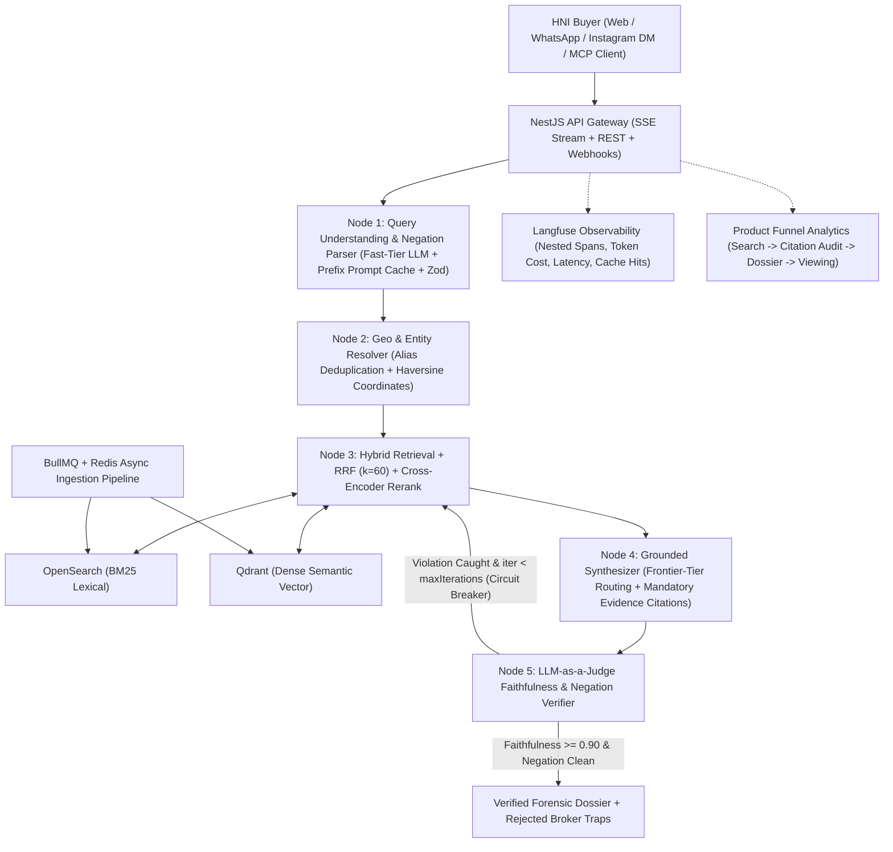

# EstateTruth AI — Production Multi-Agent Luxury Real Estate Forensics & MLOps Platform

**Live Interactive Consumer & MLOps X-Ray Sandbox:** [https://demos.soupup.ai/estatetruth](https://demos.soupup.ai/estatetruth)

**EstateTruth AI** is a customer-facing, anti-hallucination **Ultra-Luxury Real Estate Discovery & Due-Diligence Concierge** (Mumbai & Dubai) engineered to solve the two biggest failures in modern PropTech & consumer AI:
1. **Google Maps & Aggregator Blindness to Hard Negations**: Asking portals for *"quiet sea-facing 4BHK in Worli under ₹40 Cr, ZERO MahaRERA litigation, NO highway/metro noise, private lift, NO dogs"* floods users with sponsored broker traps, delayed towers, and dog-friendly listings.
2. **LLM Hallucinations in High-Stakes Transactions**: Generic chatbots invent properties, repeat inflated broker carpet-area claims, and miss active MahaRERA/DLD disputes.

Every answer from EstateTruth AI is verified by a **5-Node Cyclic LangGraph Multi-Agent Orchestrator**, grounded in first-party **MahaRERA / DLD filings, GPS acoustic sensors, floorplan vision audits, and verified resident logs**, traced span-by-span in **Langfuse**, and gated in CI by an automated **Golden Dataset + LLM-as-a-Judge Regression Suite**.

---

## System Architecture



---

## Measured Search Relevance & CI Regression Benchmarks (`npm run eval:ci`)

We **measure relevance systematically** on a curated Golden Dataset (`evals/golden_dataset.json`) rather than eyeballing LLM responses. GitHub Actions (`.github/workflows/mlops-eval-gate.yml`) blocks merges if Faithfulness `< 0.90`, Negation Compliance `< 0.95`, or Hybrid RRF fails to outperform baselines.

| Retrieval Architecture | Avg `NDCG@3` | Avg `MRR` | Hard Negation Compliance |
|---|---:|---:|---:|
| BM25 Only (OpenSearch Lexical) | `0.658` | `0.653` | Fails negation & alias traps |
| Vector Only (Qdrant Dense) | `0.846` | `0.792` | Partial negation leaks |
| **Hybrid RRF (k=60) + Negation Cross-Encoder** | **`0.898`** | **`0.958`** | **`100.0%`** |

### Real Production MLOps Failure Modes Caught & Solved During Build
1. **Score-Clipping Tie Bug**: Clamping Cross-Encoder scores prematurely into `[0, 0.99]` caused high-confidence candidates to tie at `0.99`, dropping `NDCG@3` to `0.78`. Removing premature upper-bound clipping jumped `NDCG@3` to **`0.898`** and `MRR` to **`0.958`**.
2. **Intent-Classifier Bypass Leak**: Our automated self-healing test (`simulateInitialHallucination: true`) caught a subtle bug where `"zero MahaRERA litigation"` triggered `intent = 'forensic_audit'`, causing Node 5's judge to skip the strict discovery negation guard. Fixing the intent precedence made Node 5 reliably catch the leaked trap (`Imperial Crown Heights` — 7 active RERA disputes), escalate the negation penalty (`2.5x`), cycle back to Node 3, and emit a 100% clean answer while respecting `maxIterations = 2` (Circuit Breaker).

---

## Stack & Production Capabilities

- **Backend**: **NestJS + TypeScript**, strict Zod schemas, Server-Sent Events (SSE) streaming, modular DI architecture.
- **Multi-Agent Orchestration**: **LangGraph (`@langchain/langgraph`)** 5-node cyclic state graph with compressed multi-turn session memory (preventing `AgentState` context bloat) and strict circuit-breaker iteration caps.
- **Hybrid Search & Geo**: **OpenSearch (BM25)** + **Qdrant (Dense Vector)** + **Reciprocal Rank Fusion (RRF)** + **Cross-Encoder Reranker** + **Geo Haversine & Alias Entity Resolution**.
- **MLOps Observability**: **Langfuse SDK (`langfuse`)** full trace/span attribution (`traceId`, `sessionId`, per-node latency, Fast vs Frontier model routing, prefix prompt-cache hits, USD token cost).
- **Async Event-Driven Ingestion**: **BullMQ + Redis** queue (`IngestionService`) with canonical entity deduplication across MahaRERA, DLD, resident reviews, and broker feeds.
- **Omnichannel Messaging**: **WhatsApp Cloud API & Instagram Graph API** webhook adapter (`src/modules/messaging/messaging.controller.ts`).
- **Model Context Protocol (MCP)**: Standalone MCP server (`packages/mcp-server`) exposing `search_verified_estates`, `audit_rera_compliance`, and `compare_retrieval_relevance`.
- **Product & Conversion Analytics**: End-to-end funnel telemetry (`Search -> Citation Click -> Paid Dossier Unlock -> Private Viewing Request` + CSAT).

---

## Quickstart

```bash
# 1. Install dependencies
npm install

# 2. Run the automated Golden Dataset Relevance & LLM-as-Judge CI Gate
npm run eval:ci

# 3. Boot the NestJS API locally (http://localhost:4000)
npm run start:dev

# 4. Boot the full Dockerized MLOps infrastructure (NestJS + Qdrant + OpenSearch + Redis + Langfuse)
docker compose up -d

# 5. Start the Model Context Protocol (MCP) server for Claude / Cursor / Antigravity
npm run mcp:start
```

---

## What We Would Build With 2 More Weeks

1. **Automated Live MahaRERA & DLD QPR Diff Alerts**: Scheduled BullMQ workers diffing quarterly CA Form 3 escrow filings and triggering instant WhatsApp alerts to subscribed HNI buyers when a shortlisted tower gets a new Section 18 complaint.
2. **Real-Time Multimodal Satellite Sightline Pipeline**: Automated floor-height 3D raycasting against municipal FSI/SRA redevelopment permits to predict whether a 28th-floor sea view could be obstructed in the next 5 years.
3. **Online A/B Retrieval Routing**: Split live traffic (`50/50`) across RRF `k=60` vs Distribution-Based Score Fusion (DBSF) wired directly to Langfuse scores and private-viewing conversion lift.
